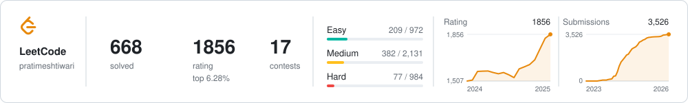
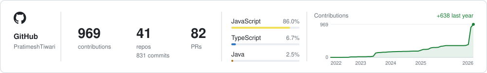

<h1 align="center">Pratimesh Tiwari</h1>

  <b>Agentic AI &amp; Backend Engineer</b> · Bengaluru, India 
  I build AI agents, developer tools and the backends they run on.

  
  
  
  

---

<table>
  <tr>
    <td width="50%" valign="top">
      <h3>Experience</h3>
      
&nbsp;<b>Software Engineer</b> · CoinDCX &nbsp;Jul 2026 – Present · Bengaluru

      
&nbsp;<b>Engineering Intern</b> · Eightfold AI &nbsp;Jan – Jul 2026 · 7 mos · Noida

      
&nbsp;<b>Backend Developer Intern</b> · Machaxi &nbsp;Sep – Dec 2025 · 4 mos · Bengaluru

      
&nbsp;<b>Summer Intern</b> · iitjobs, Inc. &nbsp;May – Jul 2024 · 3 mos · Nagpur

      
    </td>
    <td width="50%" valign="top">
      <h3>Certifications</h3>
      
&nbsp;<b><a href="https://www.credly.com/badges/aad8208f-2848-41b6-a056-3de99e0a979a/public_url">MongoDB Associate Data Modeler</a></b> &nbsp;Certified · MongoDB · Jul 2025

      
&nbsp;<b><a href="https://www.salesforce.com/trailblazer/pratimesh">Agentforce Specialist</a></b> &nbsp;Certified · Salesforce · Jan 2025

      
&nbsp;<b><a href="https://www.salesforce.com/trailblazer/pratimesh">AI Associate</a></b> &nbsp;Certified · Salesforce · Jan 2025

      
    </td>
  </tr>
</table>

### Highlights

<table>
  <tr>
    <td width="50%" valign="top">
      <h3><a href="https://github.com/PratimeshTiwari/Agent-CLI">Agent CLI</a></h3>
      A Claude Code-style coding agent for the terminal with <b>no API key</b>. It drives a Gemini tab in your
      own Chrome, then reads, searches, edits as diffs you approve and runs commands in your repo.
        
      
       
      Node.js · React/Ink · Chrome MV3 · WebSockets · VS Code extension
    </td>
    <td width="50%" valign="top">
      <h3><a href="https://github.com/PratimeshTiwari/cf_ai_agentic_interview_mate">Agentic Interview Mate</a></h3>
      An AI interviewer that runs mock interviews by voice or chat, scores each answer as you speak,
      flags answers that look read out or AI-written, and remembers you between sessions.
        
      
       
      TypeScript · Cloudflare Workers · Durable Objects · Workflows · Workers AI · Vectorize
    </td>
  </tr>
  <tr>
    <td colspan="2" valign="top">
      
      SPECIAL MENTION
      <h3>Smart India Hackathon 2024 · Participant</h3>
      Built <b><a href="https://github.com/PratimeshTiwari/SIH2024">Skill-Pilot</a></b>, a career counselling portal for
      school students. It uses the <b>Gemini API</b> to choose each next question from what the student has
      told it so far, evaluates their answers, and suggests career paths with a roadmap, in the student's
      own language.
        
      JavaScript · React · Node.js · Gemini API
    </td>
  </tr>
</table>

### Toolbox

  

<a href="https://leetcode.com/u/pratimeshtiwari/"><picture>
  <source media="(prefers-color-scheme: dark)" srcset="assets/leetcode-dark.svg">
  
</picture></a>

<a href="https://github.com/PratimeshTiwari?tab=repositories"><picture>
  <source media="(prefers-color-scheme: dark)" srcset="assets/github-dark.svg">
  
</picture></a>
