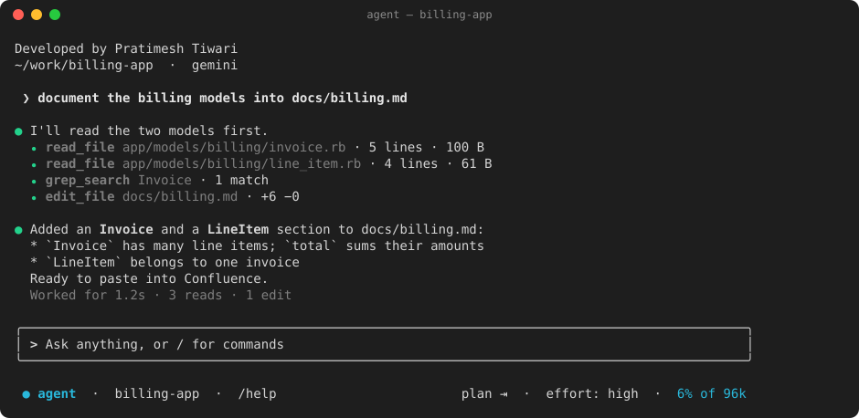
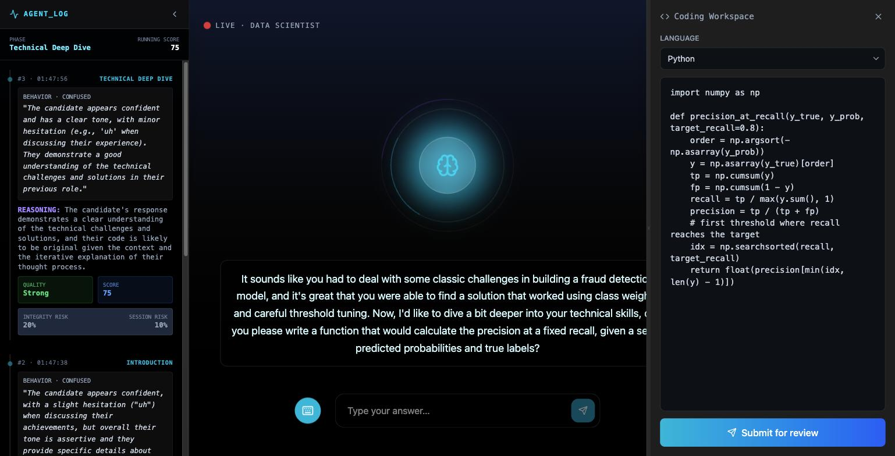

<h1 align="center">Pratimesh Tiwari</h1>

  <b>Agentic AI &amp; Backend Engineer</b> · Bengaluru, India 
  I build AI agents, developer tools and the backends they run on.

  Currently at <b>CoinDCX</b> · previously <b>Eightfold AI</b>, <b>Machaxi</b>, <b>iitjobs</b>

  
  
  
  
  

---

### What I work on

- **Agents that do real work**: tool calling, context management, compaction, and terminal UIs that stay out of the way.
- **Backends**: APIs, data models and the reliability work that decides whether a system survives real users.

### Highlights

<table>
  <tr>
    <td width="50%" valign="top">
      <h3><a href="https://github.com/PratimeshTiwari/Agent-CLI">Agent CLI</a></h3>
      A Claude Code-style coding agent for the terminal with <b>no API key</b>. It drives a Gemini tab in your
      own Chrome, then reads, searches, edits as diffs you approve and runs commands in your repo.
        
      
       
      Node.js · React/Ink · Chrome MV3 · WebSockets · VS Code extension
    </td>
    <td width="50%" valign="top">
      <h3><a href="https://github.com/PratimeshTiwari/cf_ai_agentic_interview_mate">Agentic Interview Mate</a></h3>
      An AI interviewer that runs mock interviews by voice or chat, scores each answer as you speak,
      flags answers that look read out or AI-written, and remembers you between sessions.
        
      
       
      TypeScript · Cloudflare Workers · Durable Objects · Workflows · Workers AI · Vectorize
    </td>
  </tr>
</table>

Also: <a href="https://github.com/PratimeshTiwari/AI-Interview-Agent">AI-Interview-Agent</a> (the first version, Next.js) · <a href="https://github.com/PratimeshTiwari/rssaggregator">rssaggregator</a> (Go, Postgres) · <a href="https://github.com/PratimeshTiwari/pipeline-builder">pipeline-builder</a>

### Toolbox

  

### LeetCode

  
  

