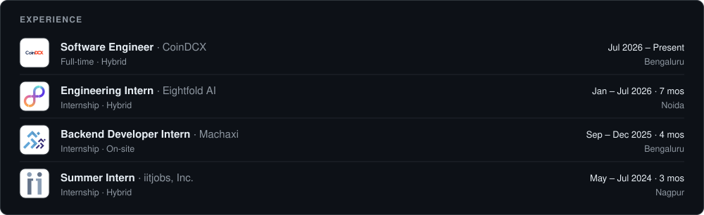
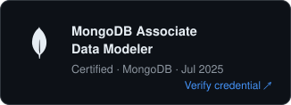
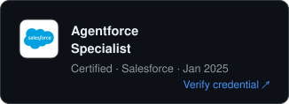
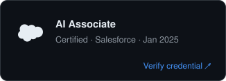
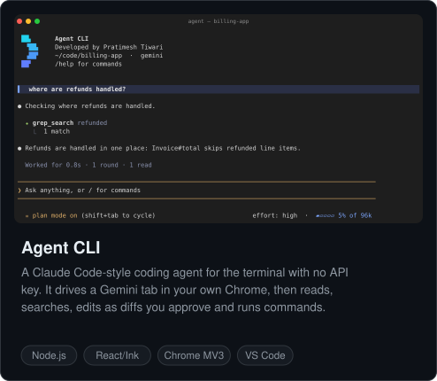
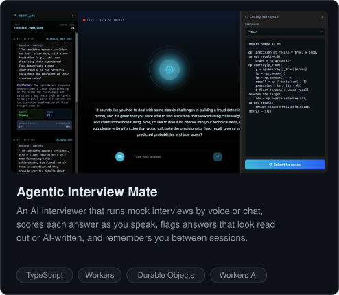
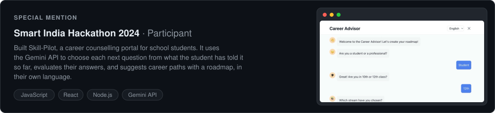
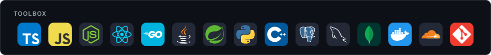
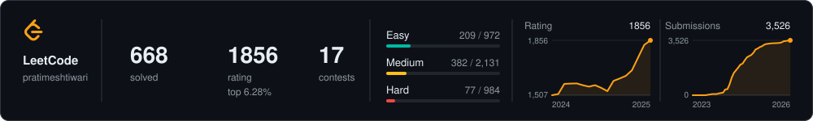
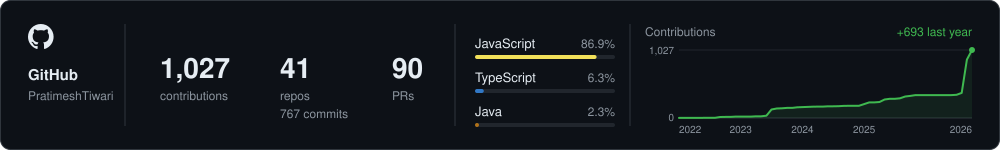

<h1 align="center">Pratimesh Tiwari</h1>

  <b>Agentic AI &amp; Backend Engineer</b> · Bengaluru, India 
  I build AI agents, developer tools and the backends they run on.

  
  
  
  

  
  
  

  
  

